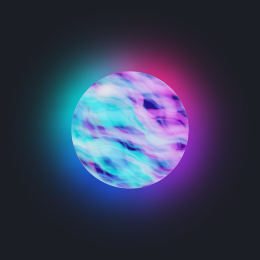
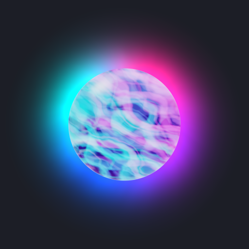

# FRIDAY — Siri UI: shipped design

> **Status: implemented.** This document describes the frontend that ships in
> `ui/` + `ui/app/`, not a proposal. Where it says "must", a test enforces it.

## Objective

FRIDAY's interface is a single, quiet, always-on-top overlay whose centrepiece is
a **1:1 volumetric Apple-Siri orb**, bottom-centre of the screen. Everything else
in the product — tools, vision, arcade, diagnostics — is reachable from it without
competing with it for attention.

There is exactly **one** UI implementation: an Electron shell around a React 19
renderer that draws the orb with WebGL2. No Tk, no Qt, no QML, no second
"fallback" frontend, and no escape-hatch environment variable. If the renderer is
not built, FRIDAY refuses to start and says exactly how to build it
(`ui.controller.missing_ui_help`).

## Stack

| Layer | Choice | Version |
|---|---|---|
| Shell | Electron | 45.x |
| UI | React + TypeScript (strict) | 19.x / 5.9 |
| Styling | Tailwind CSS v4 (`@tailwindcss/vite`) | 4.3 |
| Physics/animation | Motion (`motion/react`) | 14.x |
| Orb | WebGL2 + GLSL `#version 300 es` | — |
| Build | Vite 8 | 8.x |
| Tests | Vitest 5 + Testing Library (jsdom) | 5.x |

## Architecture

```
main.py ──► FridayUI (ui/__init__.py) ──► UiController (ui/controller.py)
                                              │
                             ┌────────────────┴─────────────────┐
                             │ WebSocket 127.0.0.1:<random port>│
                             │ + 32-byte token, close 4001      │
                             └────────────────┬─────────────────┘
                                              │ JSON deltas + binary frames
                     ┌────────────────────────┴─────────────────────┐
                     │ Electron main (electron/main.ts)             │
                     │  stage window  │  inspector window           │
                     │  transparent   │  opaque, 5 tabs             │
                     │  click-through │                             │
                     └────────┬───────┴──────────┬──────────────────┘
                              │ preload (contextBridge allow-list)
                     ┌────────┴──────────────────┴──────────────────┐
                     │ Renderer (React)                              │
                     │  StageApp → SiriOrb(WebGL2) + SnippetStack    │
                     │  InspectorApp → camera/arcade/wake/history/…  │
                     └───────────────────────────────────────────────┘
```

* The Python side owns **all** state. The renderer is a pure function of the
  `snapshot` + deltas it receives; it never computes a card, a state or a
  transcript line on its own.
* The renderer talks back only through a fixed intent set (`submit_text`,
  `toggle_mute`, `dismiss_card`, `window_dismissed`, …), validated by
  `ui/controller.py::_on_client_message`.
* `contextIsolation: true`, `nodeIntegration: false`, `sandbox: true`; the
  preload exposes a named allow-list (`fridayAPI`) and nothing else.

## The orb



*Reference render produced by an offline port of the shader's math (same
constants, same compositing) — not a WebGL screenshot. The live shader adds the
camera-independent frame timing, the damped voice spring and the dither.*



Geometry: a **204 × 204** CSS-pixel canvas whose sphere is **92 px** in radius
(92 / 204 of the half-extent, `const float R = 0.4510` in the shader), scaled by
`devicePixelRatio` (clamped to 3) for the backing store.

Compositing order inside `src/shaders/siriOrb.frag.glsl`:

1. **Feathered multi-spectral halo** — cyan → sapphire → violet → rose around the
   polar angle, `exp(-((r-R)/0.185)^1.55)` falloff, hard-zeroed before 86 % of the
   half-extent so a canvas edge can never be seen.
2. **Liquid-crystal core** — an analytic sphere normal (`z = sqrt(1 - r²)`) shades
   the interior, so it reads as glass with depth rather than a flat disc.
3. **Five silk ribbons** — additive, domain-warped by fBM, per-band irrational
   speeds so they never re-align, drifting in the sphere's tangent plane.
4. **Pole shading + chromatic Fresnel dispersion + lower-contour colour bounce** —
   the cues that make the silk look suspended *inside* the glass.
5. **Specular** — a power-90 highlight and a soft upper-left crescent, both
   clipped by the silhouette.
6. **1/255 hash dither** — an 8-bit dark desktop never bands.

Output is **premultiplied** (`fragColor = vec4(color * alpha, alpha)`) and the
canvas is created with `premultipliedAlpha: true`, so the halo blends with no grey
or black fringe over both pitch-black and pure-white wallpapers. Colour is
un-premultiplied before the multiply so `colour ≤ alpha` always holds.

### States

`dormant · summon · LISTENING · SPEAKING · THINKING · PROCESSING · acting ·
attention · error · MUTED · dismiss`

| State | Visual |
|---|---|
| dormant | loop **not scheduled** — 0 % CPU, 0 % GPU, nothing on screen |
| summon | spring scale 0 → 1, one-shot bloom (`uFlash`) |
| LISTENING | slow ambient drift, ribbons react to the mic level |
| SPEAKING | ribbons widen and lift toward the rim, faster flow |
| THINKING / PROCESSING | tighter orbital weave, orbiting energy |
| attention (confirmation pending) | warm magenta breathing pulse (`uAttention`) |
| error | 900 ms rose chromatic slip (`uError`) |
| MUTED | desaturated rose ribbons, dimmed halo, no voice reaction |
| dismiss | contract to 0.3 scale over 360 ms, then the loop stops |

Microphone level is smoothed by a **critically damped spring** (ω = 13.42,
ζ ≈ 1) so plosives never overshoot; all other uniforms are exponential
approaches, so a state change is interpolated, never popped.

`prefers-reduced-motion` (and `theme.reducedMotion`) multiplies shader time by
0.15 and replaces springs with short tweens.

## Interaction model

Windows decides click-through per window, not per element, so the renderer keeps a
**reference count of live interactive surfaces** (`useInteractiveRegion`) and flips
the window only when that count crosses zero. The Electron window is click-through
with `{ forward: true }`, which keeps hover events flowing so a surface can claim
input the moment the pointer touches it.

* Orb disc (118 px circle) → click opens the type-to-Siri pill (window pinned
  interactive while it is mounted).
* Cards → hover lifts 2 px; right-click or × dismisses; the TTL hairline drains
  for the card's lifetime.
* Esc → closes the pill, otherwise cancels the turn (`{t:"cancel"}`); forwarded
  from Electron's `before-input-event` because a click-through window does not
  always own the keyboard.
* `window_dismissed` is sent once the orb's dismissal animation completes, which
  is what releases Python's reading grace.
* Focus discipline: the stage is `focusable: false` until summoned, and blurs
  again on dismissal; the inspector is a normal, focusable window.

## Layout

```
            ┌──────────────────────────┐
            │  snippet stack (max 3)   │  newest nearest the orb
            ├──────────────────────────┤
            │  live activity capsule   │  one line + “+N”
            ├──────────────────────────┤
            │  live transcript line    │  fades by itself
            ├──────────────────────────┤
            │  type-to-Siri pill / orb │  bottom-centre
            └──────────────────────────┘
```

The stage window is 520 × 640, anchored to the bottom-centre of the primary
display's work area, transparent, frameless, `skipTaskbar`, always-on-top on the
`screen-saver` level, and excluded from screen capture
(`setContentProtection(true)`).

## Inspector

A second `BrowserWindow` (900 × 620, opaque) with five tabs — **Camera, Arcade,
Wake, History, Settings** — each fed by the same protocol on its own socket. The
overlay itself never grows a panel; detail lives here.

## Build and run

```powershell
# once
cd ui\app
npm install
npm run build

# from the repository root
python main.py
```

`python setup.py` does both. `python scripts\verify_windows_ui.py` proves the
whole chain on a real Windows box (toolchain → import purity → live WebSocket
traffic → summon → clean shutdown with no orphaned `electron.exe`).

## Quality gates

```powershell
cd ui\app
npx tsc -p tsconfig.json --noEmit          # renderer, strict
npx tsc -p tsconfig.electron.json --noEmit # main + preload
npm test                                   # Vitest (jsdom)
npm run build                              # tsc + vite → dist/

cd ..\..
python -m pytest tests\ -ra --tb=short     # full Python suite
```

## Non-goals

* No second web frontend, no QML, no Qt binding, no Tk fallback, no
  "safe-mode" UI.
* No renderer-side business logic: cards, state and transcript are Python's.
* No Tailwind `transition-*` utilities on `motion.*` elements — CSS transitions
  would fight the spring physics.
