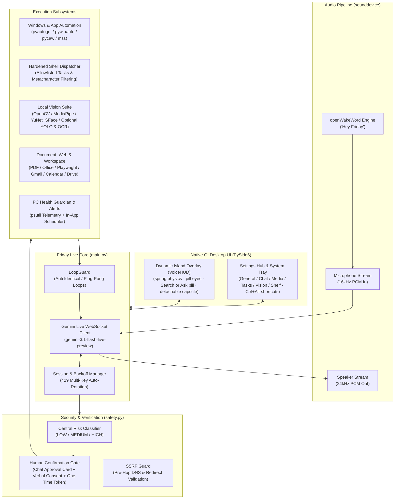

<p align="center">
  
</p>

<p align="center">
  <b>Real-Time, Voice-Driven Multimodal AI Companion for Windows</b><br>
  <i>Sub-second speech-to-speech interaction, native Dynamic Island desktop UI, local computer vision, and hardened automation.</i>
</p>

<p align="center">
  <a href="https://github.com/mayankkashyap05/friday/actions/workflows/ci.yml"></a>
  <a href="https://www.python.org/"></a>
  <a href="https://opensource.org/licenses/MIT"></a>
  <a href="https://www.microsoft.com/windows"></a>
  <a href="https://ai.google.dev/"></a>
</p>

<p align="center">
  <a href="#-project-overview">Overview</a> •
  <a href="#-system-architecture">Architecture</a> •
  <a href="#-features--tooling">Features & Tools</a> •
  <a href="#-quick-start">Quick Start</a> •
  <a href="#-security--safety-model">Security Model</a> •
  <a href="#-configuration--environment-variables">Configuration</a> •
  <a href="#-testing--verification">Testing</a> •
  <a href="#-roadmap">Roadmap</a> •
  <a href="#-contributing">Contributing</a>
</p>

---

## 💡 Project Overview

**Friday** is an open-source Windows desktop AI assistant built in Python and PySide6. All operating system control, local computer vision, UI rendering, and long-term memory run directly on your machine, while real-time voice intelligence streams to Google's **Gemini Live API** over a bidirectional WebSocket (PCM 16kHz in / 24kHz out) for low-latency conversation and natural barge-in.

Friday combines a native top-docked **Dynamic Island** overlay (with expressive animated eyes, a click-to-open Search or Ask pill, detachable floating capsule mode, and a unified Settings Hub) with 53 declarative tools covering Windows automation, screen/camera awareness, document QA, Google Workspace, Office document generation, system health monitoring, and smart home control.

### Who Is Friday For?
- **Developers & Power Users:** Seeking a customizable, local-first alternative to proprietary desktop assistants.
- **AI & Systems Researchers:** Exploring real-time multimodal tool use, human-in-the-loop safety gates, and low-latency audio pipelines.
- **Open-Source Enthusiasts:** Looking for a clean, extensible Python codebase with zero telemetry, zero forced subscriptions, and full self-hosting control.

---

## 🏗️ System Architecture

Friday runs on a decoupled architecture that isolates the Qt GUI thread (`PySide6`) from the asynchronous Gemini Live engine (`asyncio`), blocking tool workers, and hardware audio streams (`sounddevice`). Cross-thread updates pass through a bounded FIFO dispatcher (`ui/bridge/bridge.py`) so audio dropouts, slow tools, or network reconnects never freeze the desktop interface.



---

## ✨ Features & Tooling

Friday exposes **53 declarative tools** to Gemini, each guarded by centralized risk classification, per-tool execution timeouts, bounded retry resilience, and loop detection.

| Category | Capabilities & Implemented Modules | Local vs. Cloud |
| --- | --- | --- |
| 🎙️ **Real-Time Voice & Personas** | Bidirectional Gemini Live speech streaming, barge-in support, 30 customizable Gemini voices, 6 conversation modes (`normal`, `butler`, `friend`, `casual`, `girlfriend`, `crazy_friend`), 4 moods, and local wake-word training/listening (`actions/wake_word.py`, `actions/friday_wake.py`). | Cloud LLM + Local Audio |
| 🫧 **Native Dynamic Island UI** | Top-docked translucent PySide6 overlay (`ui/island/voice_hud.py`) with spring physics, animated gaze/blink eyes, click-to-open Search or Ask bar, detachable floating capsule, drag-and-drop file shelf, dark/light themes, procedural UI sound cues, fullscreen auto-hide, and unified Settings Hub (`ui/panels/settings_window.py`). | 100% Local |
| 🖥️ **Windows & App Automation** | Launch apps, manage windows, control master/per-app volume (`pycaw`), brightness, dark mode, Wi-Fi, clipboard history, global media keys, screenshots, file operations/auto-organization with undo, zip/unzip, Windows Task Scheduler reminders, and login autostart. | 100% Local |
| 🔒 **Safety & Risk Gate** | Centralized risk engine (`safety.py`). `Risk.HIGH` calls require explicit human approval via the Chat confirmation card or verbal/text consent bound to a single-use, argument-fingerprinted `confirm_token`, plus optional local face identity verification (`face_verify`). | 100% Local |
| 👁️ **Visual Awareness & CV** | Screen/camera Q&A (`actions/screen_processor.py`), click-by-description (`actions/vision_click.py`), MediaPipe gestures/air-mouse/pinch-volume/posture, OpenCV privacy face blur, YuNet+SFace local face verification, GrabCut background removal, QR/barcode reading, and optional YOLO/Tesseract OCR (`vision/`). | Local CV + Cloud VLM |
| 🧠 **Persistent Memory** | Structured long-term memory (`memory/memory_manager.py` → `memory/long_term.json`) storing identity, preferences, projects, relationships, wishes, and notes with automatic secret filtering, value truncation, and per-category pruning. | Local Storage + Cloud Extraction |
| 🛡️ **PC Health Guardian & Watchdogs** | Out-of-the-box health monitoring (`actions/guardian.py`) for battery level/wear, disk space, RAM, CPU, temperature, and backup reminders, plus custom threshold alerts (`actions/monitor.py`), Gmail new-mail alerts, and in-app timed reminders. | 100% Local |
| 📄 **Documents, Office & Web** | Question-answering over PDF, DOCX, PPTX, XLSX, HTML, TXT, Markdown, and URLs with SSRF protection (`actions/document_qa.py`, `actions/pdf_reader.py`), PowerPoint/Excel file generation (`actions/office_builder.py`), web search with DuckDuckGo fallback, YouTube playback/summarization, and visible browser automation via Playwright (`actions/browser_control.py`). | Local Parsing + Cloud QA |
| 📧 **Google Workspace & Utilities** | Google OAuth2 integration (`google_oauth.py`) for Gmail (send/read/watch), Google Calendar (list/add/delete), and Google Drive (list/search/read/upload), alongside code writing/debugging (`actions/code_helper.py`, `actions/dev_agent.py`), multi-step background tasks (`agent/`), Steam/Epic game updater, flight search, weather, translation, and daily briefings. | Local + Google APIs |
| 🏠 **Smart Home** | Control lights, switches, and devices via Home Assistant REST API, custom webhooks, or offline simulated mode (`actions/smart_home.py`). | Local / LAN |

---

## 📦 Requirements

* **Operating System:** Windows 10 or Windows 11 (64-bit).
* **Python Runtime:** Python **3.11, 3.12, 3.13, or 3.14**.
* **Hardware:**
* Standard microphone and speakers / headphones (gracefully degrades to text mode if audio hardware is unavailable).
* Webcam (optional — only needed for camera vision, gestures, or local face verification).


* **API Key:** A Google Gemini API key from [Google AI Studio](https://aistudio.google.com/apikey).

---

## 🚀 Quick Start

### 1. Clone the Repository

```powershell
git clone [https://github.com/mayankkashyap05/friday.git](https://github.com/mayankkashyap05/friday.git)
cd friday

```

### 2. Create and Activate Virtual Environment

```powershell
python -m venv .venv
.\.venv\Scripts\activate

```

### 3. Run Setup

The setup script installs Python dependencies (including PySide6), installs Playwright's Chromium browser, and creates default JSON config files from `config/*.example.json`:

```powershell
python setup.py

```

### 4. Configure Your Gemini API Key

Open `config/api_keys.json` and add your Gemini API key:

```json
{
    "gemini_api_key": "AIzaSyYourActualKeyHere...",
    "gemini_api_keys": []
}

```

*(Alternatively, set `FRIDAY_GEMINI_API_KEY` in your environment, or enter the key in Friday's first-run setup dialog).*

### 5. Launch Friday

```powershell
python main.py

```

You can also launch a single instance via PowerShell (`.\start_friday.ps1`) or run without the desktop overlay/tray (`python main.py --headless`).

#### Global Keyboard Shortcuts

When the optional `keyboard` library is active, Friday registers these shortcuts:

* `Ctrl+Alt+M` — Mute / unmute microphone
* `Ctrl+Alt+W` — Start / stop wake-word listener
* `Ctrl+Alt+H` — Show / hide the Dynamic Island notch
* `Ctrl+Alt+B` — Trigger daily briefing
* `Ctrl+Alt+Q` — Quit Friday

---

## 🛡️ Security & Safety Model

Because Friday can interact with files, applications, and system settings, safety is enforced centrally rather than per-tool:

1. **Centralized Risk Hierarchy (`safety.py`):**
* **`Risk.LOW`:** Read-only and local preference operations (web search, reading documents, weather, system status, memory lookup). Never require confirmation.
* **`Risk.MEDIUM`:** Reversible or bounded state changes (opening apps, timers, clipboard, window controls, autostart toggles).
* **`Risk.HIGH`:** Destructive, external-send, or arbitrary-execution actions (file deletion/moves/organization/unzip, shell commands, desktop actions, sending Gmail, killing processes, running/building code, system shutdown/restart/sleep, Drive deletion, game updates).


2. **Human Confirmation & One-Time Token Binding:**
* The LLM cannot self-approve `Risk.HIGH` tools.
* On first attempt, the gate blocks execution, issues a single-use cryptographic `confirm_token` bound to the exact `(tool, sanitized args)` fingerprint (10-minute TTL, capped pool size), and displays a sanitized **Approve / Deny** card in the Settings Hub Chat tab while asking the user for permission.
* Execution proceeds only after explicit human approval (clicking **Approve** or giving an unambiguous confirmation such as `"yes"`, `"approve"`, or `"proceed"`) and echoing the matching token.
* **Multi-Pending Request Isolation:** Human consent is bound strictly to the active pending token and consumed immediately on execution, preventing replay or cross-action leakage.
* **Background Agent Hardening:** The autonomous background executor (`agent/executor.py`) refuses `Risk.HIGH` tools that require interactive confirmation, and `generated_code` execution is disabled by default.


3. **Pre-Hop SSRF & Path Traversal Protection:**
* `actions/document_qa.py` resolves target hostnames before fetching and blocks private subnets (`10.0.0.0/8`, `172.16.0.0/12`, `192.168.0.0/16`, `127.0.0.0/8`), link-local addresses (`169.254.0.0/16`), IPv6 loopback (`::1`), and cloud metadata endpoints (`metadata.google.internal`), validating every redirect hop.
* `actions/file_controller.py` guards archive extraction against zip-slip path traversal, and `actions/dev_agent.py` blocks path escapes outside the project directory.


4. **Data Privacy & What Leaves Your Machine:**
* **Leaves Your Machine:** Encrypted audio frames (PCM 16kHz in / 24kHz out) stream to Google's Gemini Live API (`gemini-3.1-flash-live-preview`), along with text/image payloads for cloud-backed tools you invoke (web search, screen/document QA, translation, Google Workspace).
* **Stays 100% On-Device:** OS automation, PySide6 UI rendering, MediaPipe/OpenCV computer vision (face privacy blur, gestures, local YuNet+SFace face profiles), long-term memory (`memory/long_term.json`), PC Health Guardian telemetry, and confirmation tokens.


5. **Secret Redaction:**
* API keys, tokens, passwords, and secrets are automatically masked (`***`) in logs (`logger.py`), safety descriptions (`safety.py`), and rejected from long-term memory storage (`memory/memory_manager.py`).


6. **Declarative Desktop Dispatch:**
* `actions/desktop.py` routes high-level desktop tasks to structured built-in handlers rather than running arbitrary LLM-generated code, and `actions/cmd_control.py` restricts model-supplied commands against destructive patterns and shell metacharacters.


---

## ⚙️ Configuration & Environment Variables

Runtime configuration lives in `config/` (git-ignored for secrets):

| File | Purpose |
| --- | --- |
| `config/api_keys.json` | Gemini API key(s), optional Gmail app password (`gmail_user`, `gmail_app_password`), and optional Google OAuth credentials (`google_client_id`, `google_client_secret`). |
| `config/ui_settings.json` | Native UI settings (theme, opacity, notch/eye colours, animations, UI sounds, fullscreen auto-hide, dictation style, detached capsule positions). |
| `config/guardian.json` | PC Health Guardian alert thresholds and cooldowns. |
| `config/smart_home.json` | Smart home backend (`home_assistant`, `webhook`, or `simulated`) and device registry. |

### Supported Environment Variables

| Environment Variable | Purpose |
| --- | --- |
| `FRIDAY_GEMINI_API_KEY` | Primary Google Gemini API key (overrides/prepends to `config/api_keys.json`). |
| `FRIDAY_GEMINI_API_KEYS` | Comma-separated list of Gemini API keys for automatic 429 quota rotation. |
| `FRIDAY_VISION_MODEL` | Optional model override for `actions/screen_processor.py`. |
| `FRIDAY_YOLO_MODEL` | Optional custom YOLO weights path for `vision/model_manager.py`. |

---

## 🧪 Testing & Verification

Friday includes an automated `pytest` suite covering the safety gate, SSRF and zip-slip defenses, API key rotation, memory management, computer vision pipelines, and the native PySide6 UI (run offscreen via `QT_QPA_PLATFORM=offscreen`).

Run the test suite locally:

```powershell
pytest -v

```

Continuous integration runs via [GitHub Actions](https://www.google.com/search?q=.github/workflows/ci.yml) across Windows runners.

---

## 🗺️ Roadmap

* [x] Bidirectional real-time Gemini Live WebSocket streaming (`gemini-3.1-flash-live-preview`).
* [x] Native PySide6 Dynamic Island overlay, Search or Ask popup, and unified Settings Hub.
* [x] Hardened human-consent security gate (Chat approval card + verbal consent + single-use `confirm_token`).
* [x] Decoupled audio hardware failure recovery (graceful degradation to text mode).
* [ ] **External-App Dictation Integration:** Connect the focus-checked clipboard paste primitives in `ui/island/dictation_paste.py` to an isolated speech-to-text stream separate from live assistant commands.
* [ ] **Local Offline Voice Fallback:** On-device STT/TTS (e.g., Whisper.cpp / Piper) when internet connectivity is unavailable.
* [ ] **Multi-Monitor Spatial Vision:** Improved UI element localization and overlay ergonomics across mixed-DPI multi-monitor setups.
* [ ] **Modular Plugin SDK:** Packaging custom tools as standalone installable Python extensions.

---

## 🤝 Contributing

Contributions are warmly welcomed! Please read our [Contributing Guide](CONTRIBUTING.md) and [Code of Conduct](CODE_OF_CONDUCT.md) before submitting pull requests.

For security concerns, please refer to our [Security Policy](SECURITY.md).

---

## 📄 License & Acknowledgments

This project is licensed under the **[MIT License](https://www.google.com/search?q=LICENSE)** — free for personal, educational, and commercial use.
