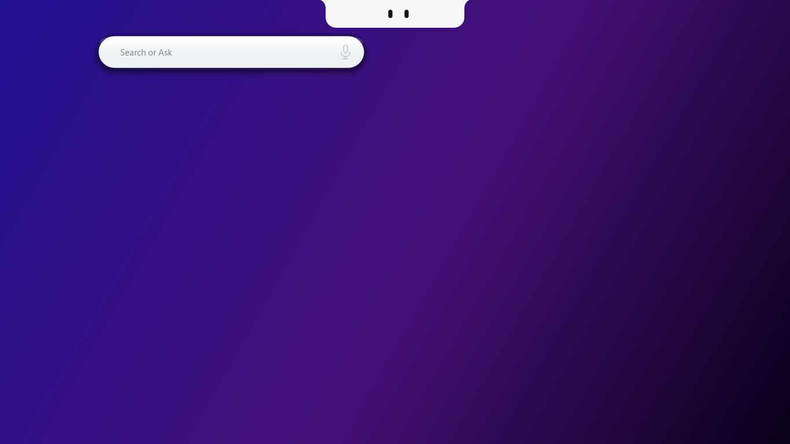
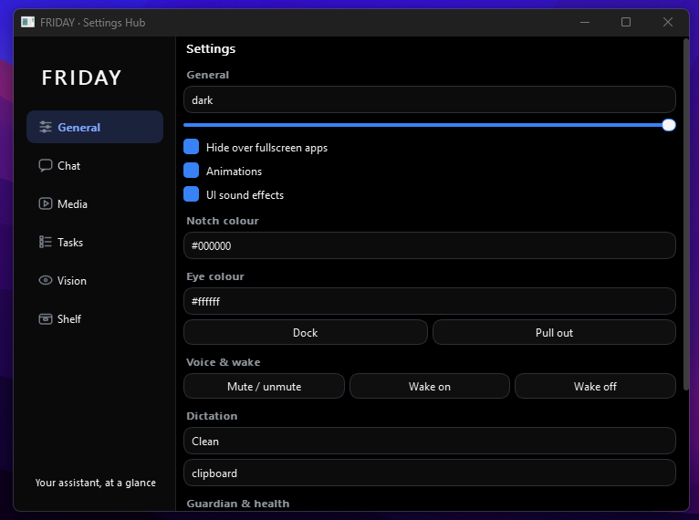

<p align="center">
  
</p>

<h1 align="center">FRIDAY</h1>

<p align="center">
  <b>Real-Time, Voice-Driven Multimodal AI Companion for Windows, macOS & Linux</b><br>
  <i>Sub-second speech-to-speech interaction, native Dynamic Island UI, modular desktop vision, autonomous tooling, and hardened local automation.</i>
</p>

<p align="center">
  <a href="https://www.python.org/"></a>
  <a href="https://opensource.org/licenses/MIT"></a>
  <a href="https://www.microsoft.com/windows"></a>
  <a href="https://www.apple.com/macos/"></a>
  <a href="https://www.kernel.org/"></a>
  <a href="https://ai.google.dev/"></a>
  <a href="https://doc.qt.io/qtforpython-6/"></a>
</p>

<p align="center">
  <a href="#-project-overview">Overview</a> •
  <a href="#-system-architecture">Architecture</a> •
  <a href="#-features--tooling">Features & Tools</a> •
  <a href="#-quick-start">Quick Start</a> •
  <a href="#-security--safety-model">Security Model</a> •
  <a href="#-configuration">Configuration</a> •
  <a href="#-testing--verification">Testing</a> •
  <a href="#-roadmap">Roadmap</a> •
  <a href="#-contributing">Contributing</a>
</p>

---

## 🧠 Project Overview

**FRIDAY** is a real-time, voice-first desktop AI companion engineered around **Google Gemini Live**, a native **PySide6 / Qt6 Dynamic Island interface**, a **53-tool** safety-gated automation suite, a multi-step **autonomous agent engine**, a local **computer-vision platform**, and curated **long-term memory**.

It runs across **Windows, macOS, and Linux** with platform-native overlay integration on Windows 10/11 and macOS, while keeping startup fast via lazy on-demand action imports and protecting sensitive desktop actions behind cryptographic, human-approved confirmation tokens.

### Interface Previews

<table>
  <tr>
    <td align="center" width="50%">
      <br>
      <sub><b>Top-Docked Notch &amp; Liquid-Glass "Search or Ask" Pill (Dark)</b></sub>
    </td>
    <td align="center" width="50%">
      <br>
      <sub><b>Live Speech State with Transcript &amp; 5-Bar Waveform</b></sub>
    </td>
  </tr>
  <tr>
    <td align="center" width="50%">
      <br>
      <sub><b>Light Mode Notch &amp; Search Pill</b></sub>
    </td>
    <td align="center" width="50%">
      <br>
      <sub><b>Unified 6-Tab Settings Hub (General, Chat, Media, Tasks, Vision, Shelf)</b></sub>
    </td>
  </tr>
</table>

### Key Highlights

- **Sub-second Gemini Live Voice Pipeline** — Full-duplex 16 kHz PCM capture / 24 kHz PCM playback with live transcription, tool calling, automatic reconnect backoff, and multi-key quota failover. Model IDs are centralized in [`config/models.py`](config/models.py): `MODEL_LIVE = "gemini-3.1-flash-live-preview"`, `MODEL_FLASH = "gemini-3.8-flash"`, and `MODEL_FLASH_LITE = "gemini-3.5-flash-lite"`.
- **Native Dynamic Island UI (PySide6 / Qt6)** — Frameless top-docked notch with spring physics, expressive pill-eye mascot, live audio waveform, floating `"Search or Ask"` pill, drag-to-detach capsule, dark/light themes, system tray, and a 6-tab Settings Hub (`ui/`).
  - **Windows 10/11**: Win32 hit-testing, `WS_EX_NOACTIVATE` non-focus-stealing overlay, event-driven topmost Z-order guard (`ui/island/win32_overlay.py`), and automatic Administrator elevation on launch (opt out with `--no-admin` or `FRIDAY_NO_ADMIN=1`).
  - **macOS (Apple Silicon & Intel)**: Zero-duplication **`ui_mac/` dynamic Cocoa bridge** (PEP 562 live proxy over `ui/`) that injects AppKit `NSPanel`-style full-screen Spaces overlay behavior, MacBook notch/menu-bar anchoring (`ui_mac/notch_anchor.py`), SF Pro / SF Mono font mapping, and native `Cmd+V` dictation paste via PyObjC (`ui_mac/cocoa_paste.py`).
- **53 Safety-Gated Tools Across 39 Action Modules** — Instant cached app launching (`<20 ms`), desktop/OS settings, persistent Playwright browser automation, Google Workspace (Gmail, Calendar, Drive), Office `.pptx`/`.xlsx` generation, PDF/Document Q&A, smart home control, Steam/Epic game updates, wake word, and screen/camera vision.
- **Hardened Security & Human-in-the-Loop Confirmation** — Centralized `LOW` / `MEDIUM` / `HIGH` risk classification in [`safety.py`](safety.py), single-use SHA-256 argument-bound confirmation tokens, out-of-band UI card & explicit verbal consent, optional local face verification, SSRF & sandbox guards, and multi-layer secret redaction.
- **Persistent Persona & Long-Term Memory** — 30 Gemini prebuilt voices, 6 personality modes (`normal`, `butler`, `friend`, `casual`, `girlfriend`, `crazy_friend`), 4 moods (`calm`, `playful`, `romantic`, `strict`), multilingual replies, and automatic 2-stage memory extraction stored locally in `memory/long_term.json`.

---

## 📐 System Architecture

### Runtime Data Flow

```text
  Microphone (16 kHz) / Text / Hotkeys / Wake Word / Camera
                             │
                             ▼
  ┌──────────────────────────────────────────────────────────┐
  │                    main.py (FridayLive)                  │
  │  Gemini Live WebSocket · Audio I/O · Scheduler · Monitor │
  └───────┬──────────────────┬──────────────────┬────────────┘
          │                  │                  │
          ▼                  ▼                  ▼
  ┌───────────────┐  ┌───────────────┐  ┌────────────────────┐
  │  Safety Gate  │  │  ui/bridge/   │  │ memory/            │
  │  safety.py    │  │  EventBus ->  │  │ memory_manager.py  │
  │  LoopGuard    │  │  Qt Thread    │  │ (2-stage extract   │
  │  Resilience   │  │  VoiceHUD &   │  │  + secret filter)  │
  │  Face Verify  │  │  Settings Hub │  └────────────────────┘
  └───────┬───────┘  └───────┬───────┘
          │                  │  (macOS PEP 562 proxy)
          │                  ▼
          │          ┌───────────────┐
          │          │   ui_mac/     │
          │          │ Cocoa Overlay │
          │          │ & Cmd+V Paste │
          │          └───────────────┘
          ▼
  ┌──────────────────────────────────────────────────────────┐
  │      Tool Dispatch (53 Declared Tools · Lazy Loaded)     │
  ├────────────────────┬──────────────────┬──────────────────┤
  │  actions/ (39)     │  agent/ (6)      │  vision/ (21)    │
  │  OS, Files, Web,   │  TaskQueue ->    │  CameraManager   │
  │  Google Workspace, │  Planner ->      │  VisionPipeline  │
  │  Dev, Smart Home,  │  Executor ->     │  YOLO / MediaPipe│
  │  Media, Wake Word  │  ErrorHandler    │  YuNet+SFace/OCR │
  └────────────────────┴──────────────────┴──────────────────┘
```

### Repository Structure

```text
FRIDAY/
├── main.py                  # Entry point, CLI flags, Windows UAC elevation, Gemini Live loop & 53 tools
├── api_keys.py              # Multi-key Gemini loading, 8h quota cooldown rotation, overload failover
├── safety.py                # Centralized LOW/MEDIUM/HIGH risk policy, single-use tokens, arg redaction
├── google_oauth.py          # Desktop OAuth 2.0 PKCE (S256) loopback flow & atomic token storage
├── logger.py                # Stdout/stderr tee logger with defense-in-depth secret redaction
├── setup.py                 # Installer: pip requirements, Playwright Chromium, default config scaffolding
├── start_friday.ps1         # Windows single-instance PowerShell launcher (prefers .venv)
├── pyproject.toml           # Project metadata, packaging config, optional deps & pytest config
├── requirements.txt         # Cross-platform dependencies (PEP 508 platform markers)
├── actions/                 # 39 automation & integration modules (lazy-imported at tool invocation)
├── agent/                   # Autonomous TaskQueue, Planner, Executor, ErrorHandler, Resilience, LoopGuard
├── config/                  # Model IDs (models.py), audio policy (audio.py), *.example.json templates
├── core/                    # System instruction prompt (prompt.txt)
├── memory/                  # Categorized long-term memory extraction, pruning, search & persistence
├── models/                  # Local ONNX / TFLite / PyTorch models (YOLO11n, Holistic, YuNet, SFace, etc.)
├── ui/                      # Native PySide6/Qt6 UI (source of truth: island, mascot, bridge, panels, tray, themes)
├── ui_mac/                  # Zero-duplication macOS Cocoa bridge & PEP 562 dynamic proxy over ui/
├── vision/                  # 21-module computer-vision platform (pipeline, detectors, OCR, privacy, arcade)
├── docs/                    # Architecture & planning docs (VISION_PLATFORM_PLAN.md; see also ui/ARCHITECTURE.md)
├── artifacts/ui_previews/   # 15 offscreen-rendered UI scene snapshots for visual verification
├── assets/                  # Branding logo & visual reference assets
└── tests/                   # 73 offline-focused pytest regression suites (845 test functions)
```

### Core Subsystems

| Subsystem | Location | Responsibilities |
| --- | --- | --- |
| **Live Voice & Session Runtime** | `main.py`, `config/audio.py` | Manages full-duplex `sounddevice` streams (16 kHz in / 24 kHz out), shared end-of-speech grace & watchdog policy (`AUDIO_END_GRACE_S = 0.35s`, `SPEAKING_WATCHDOG_S = 8.0s`), exponential reconnect backoff (`3s` → `60s`), fatal schema-error (`1007`) circuit breaking, and background scheduler/monitor loops. |
| **Multi-Key Resilience** | `api_keys.py`, `config/models.py` | Loads keys from environment variables and `config/api_keys.json`, marks `429 RESOURCE_EXHAUSTED` keys with an 8-hour cooldown in `config/api_key_state.json`, retries transient `503`/timeout failures once, and fails over from `MODEL_FLASH` to `MODEL_FLASH_LITE`. |
| **Autonomous Agent Engine** | `agent/` | Priority `TaskQueue` (`HIGH`/`NORMAL`/`LOW`), `planner.py` (up to 5-step JSON plans + dynamic replanning), `executor.py` (180 s per-tool cap, cross-step context injection & goal-language translation, strict background safety blocking), `error_handler.py` (`RETRY`/`SKIP`/`REPLAN`/`ABORT`), `resilience.py`, and `loop_guard.py`. |
| **Native UI & Bridge** | `ui/`, `ui_mac/`, [`ui/ARCHITECTURE.md`](ui/ARCHITECTURE.md) | Thread-safe queued delivery (`ui/bridge/event_bus.py` → `bridge.py` → `controller.py`) keeping all widget work on the Qt thread; spring physics (`0.5s` response, `0.72` damping, `1/240s` substeps) and deterministic FSM (`ui/island/fsm.py`); `ui_mac/` dynamically patches `win32_overlay`, `dictation_paste`, fonts, and Cocoa window flags on `darwin` without duplicating any UI file. |
| **Computer Vision Platform** | `vision/`, `models/` | Thread-safe shared `CameraManager`, composable `VisionPipeline`, unified `VisionEvent` schema, SQLite `EventStore`, and bundled local models (`yolo11n.pt`, `holistic_landmarker.task`, `face_detection_yunet_2023mar.onnx`, `face_recognition_sface_2021dec.onnx`, `face_detector.tflite`, `embedding_model.onnx`, `melspectrogram.onnx`). |
| **Long-Term Memory** | `memory/memory_manager.py` | Two-stage (`YES/NO` filter → structured JSON extraction) persistence via `MODEL_FLASH_LITE` across 6 categories (`identity`, `preferences`, `projects`, `relationships`, `wishes`, `notes`), capped at 40 entries per category, secret-filtered before saving atomically to `memory/long_term.json`. |

---

## 🧰 Features & Tooling

FRIDAY exposes **53 declared tools** to Gemini Live backed by **39 action modules** and a **21-module vision stack**. Modules are lazily imported when invoked to keep startup instantaneous.

### 1. OS, System & Desktop Automation

| Tool(s) | Module | Capabilities |
| --- | --- | --- |
| `open_app` | `actions/open_app.py` | Sub-20 ms cached cross-platform app launcher (`data/app_index_cache.json`) with stale-while-revalidate refresh, Start Menu / App Paths / Uninstall / UWP `Get-StartApps` deduplication, UAC-safe AUMID launch, URI schemes, and multi-app disambiguation. |
| `computer_settings` | `actions/computer_settings.py` | System volume & per-app audio control, screen brightness, dark/light mode, Wi-Fi, zoom, tabs, screenshots, lock, sleep, hibernate, restart, and shutdown. |
| `computer_control` | `actions/computer_control.py` | Keyboard typing (`type`, `smart_type`), hotkeys, key presses, mouse clicks (`left`/`triple`/`middle`/`hover`/`drag`/`scroll`), window enumeration/focus/management, and visual `screen_find` / `screen_click`. |
| `desktop_control` | `actions/desktop.py` | Wallpaper switching (local path or URL) with undo, desktop cleaning/organization with undo, directory stats, and sandboxed desktop automation. |
| `cmd_control` | `actions/cmd_control.py` | Hardened CMD / PowerShell / POSIX execution with curated modern CIM system-info intents, blocklist/metacharacter screening, dry-run mode, and redacted command history. |
| `system_status` | `actions/system_status.py` | Live CPU, RAM, disk, battery, GPU, temperature, network, hardware, uptime, and top-process telemetry (`brief`, `detailed`, or `json`). |
| `task_manager` | `actions/task_manager.py` | Background agent task inspection/cancellation (`list`, `status`, `cancel`, `summary`) plus OS process discovery and termination (`processes`, `find_process`, `kill`). |
| `clipboard` | `actions/clipboard.py` | Clipboard read/write/paste/clear, searchable history, pinning, text transforms, append, file-list reading, and clipboard image saving. |
| `media_control` | `actions/media_control.py` | System media transport (`play`, `pause`, `toggle`, `next`, `prev`), volume steps/mute, and `now_playing` metadata. |
| `notify` | `actions/notifications.py` | Native desktop toast notifications with customizable duration, sound profile (`default`, `none`, `alarm`, `reminder`), clickable URLs, and history. |
| `reminder`, `schedule` | `actions/reminder.py`, `main.py` | Natural-language and recurring reminders (`once`, `daily`, `weekly`) plus timed scheduled assistant commands. |
| `autostart` | `actions/autostart.py` | Cross-platform login startup registration (`enable`, `disable`, status). |
| `pc_health` | `actions/guardian.py` | Proactive debounced PC Health Guardian alerting on low/full battery, low disk space, high CPU/RAM/temperature, and overdue backups, with snooze controls. |
| `monitor_alerts`, `email_watch` | `actions/monitor.py` | Custom sustained-threshold alert rules (`cpu`, `ram`, `disk`, `battery`, `temp`, `process_exit`) and background new-email watcher with sender/subject filters. |
| *(Tray & Hotkeys)* | `actions/system_tray.py`, `ui/tray/` | System tray menu plus global keyboard shortcuts (`Ctrl+Alt+M/W/H/B/Q`). |

### 2. Files, Documents & Office Productivity

| Tool(s) | Module | Capabilities |
| --- | --- | --- |
| `file_controller` | `actions/file_controller.py` | Create, read, write, list, find, copy, move, rename, Recycle-Bin delete (`send2trash`), zip/unzip, disk usage, duplicate finder, content search, recent files, and extension/AI-based folder organization with undo log (`data/organize_log.json`). |
| `read_pdf`, `pdf_qa` | `actions/pdf_reader.py` | PDF preview, page-range extraction, keyword search, metadata inspection, layout/visual mode, password-protected PDF support, and question answering. |
| `read_document`, `document_qa` | `actions/document_qa.py` | Local document and SSRF-protected web page extraction, summarization, search, stats, and Q&A. |
| `create_presentation`, `create_spreadsheet` | `actions/office_builder.py` | Generates styled PowerPoint (`.pptx`) decks and multi-sheet Excel (`.xlsx`) workbooks with headers, rows, and summary rows. |

### 3. Web, Research, Travel & Media

| Tool(s) | Module | Capabilities |
| --- | --- | --- |
| `browser_control` | `actions/browser_control.py` | Persistent Playwright Chromium automation (or Chrome CDP attach) with compact ARIA snapshots, semantic/CSS clicking, typing, form filling, tab management, link/text extraction, and screenshots. |
| `web_search` | `actions/web_search.py` | DuckDuckGo (`ddgs`) web search, news, quick lookups, and structured multi-item comparisons with time-range and regional filtering. |
| `youtube_video` | `actions/youtube_video.py` | Deterministic YouTube search, playback controls, seek/forward/rewind, speed, volume/mute, captions, theater/fullscreen/miniplayer, ad skipping, trending feeds, video info, and transcript summarization. |
| `weather_report` | `actions/weather_report.py` | Current conditions, tonight/tomorrow/weekly/weekend forecasts, metric/imperial units, and AQI (defaults to city stored in memory). |
| `flight_finder` | `actions/flight_finder.py` | Flight search by origin, destination, date, passengers, cabin class, non-stop/max-stops, currency, and sorting by price or duration. |
| `translate` | `actions/translate.py` | Text, clipboard, and batch translation with language detection, transliteration, tone control, and grammatical explanations. |
| `game_updater` | `actions/game_updater.py` | Steam & Epic Games library listing, largest games, install, update, launch, close, download progress, scheduling, and cancellable shutdown-on-completion. |

### 4. Google Workspace, Comms & Smart Home

| Tool(s) | Module | Capabilities |
| --- | --- | --- |
| `gmail` | `actions/gmail.py` | Full parity across Google OAuth API and App-Password IMAP/SMTP: `read`, `search`, `read_message`, `send`, `draft`, threaded `reply`, `mark_read`/`mark_unread`, `unread_count`, `trash`, `delete`, and attachments up to 25 MB. |
| `calendar` | `actions/calendar.py` | Google Calendar v3: `list`, `today`, `tomorrow`, `week`, `search`, `add`, `update`, `reschedule`, `delete`, `free_busy`, `find_slot`, recurrence, reminders, and conference links. |
| `drive` | `actions/drive.py` | Google Drive: `list`, `search`, `read`, `info`, `upload`, `download`, `create_folder`, and `trash`. |
| `google_auth`, `google_auth_status` | `google_oauth.py` | Browser-based Desktop OAuth PKCE (S256) sign-in flow and connection diagnostics. |
| `daily_briefing` | `actions/daily_briefing.py` | Unified briefing combining weather, calendar, email, reminders, tasks, system status, memory highlights, and opt-in news. |
| `send_message` | `actions/send_message.py` | Desktop/web messaging (WhatsApp and configured platforms) with optional `dry_run` preview. |
| `smart_home_control` | `actions/smart_home.py` | Controls lights, switches, locks, covers, and climate via Home Assistant REST API, custom webhooks, or an offline `simulated` mode. |

### 5. Developer Tools & Autonomous Agent

| Tool(s) | Module | Capabilities |
| --- | --- | --- |
| `code_helper` | `actions/code_helper.py` | Code writing, unified-diff previewed edits (`dry_run`) with `undo_edit`, explanation, optimization, refactoring, code/security review & audit, test generation/execution, and screen debugging. |
| `dev_agent` | `actions/dev_agent.py` | End-to-end project builder (`build`, `list_projects`, `run_project`, `fix_project`) with optional test runs and editor launch. |
| `agent_task` | `agent/` | Dispatches complex multi-step goals to the background priority `TaskQueue` with planning, error recovery, and automatic replanning. |

### 6. Vision Platform, Screen Intelligence & Wake Word

| Tool(s) | Module(s) | Capabilities |
| --- | --- | --- |
| `screen_process` | `actions/screen_processor.py` | Multimodal analysis of full screen, active window, custom region, or webcam (`fast`, `balanced`, `high`, `ocr` modes, multi-monitor support). |
| `vision_click` | `actions/vision_click.py` | Locates UI targets from natural-language descriptions and performs click/hover/type actions across monitors. |
| `vision_gesture` | `actions/vision_gesture.py` | Real-time MediaPipe vision modes: `gesture`, `air_mouse`, `volume`, `motion`, `posture`, `objects`, `focus`, plus `face_count`, `qr` scanning, `snapshot`, and `verify_identity`. |
| `wake_word` | `actions/wake_word.py`, `actions/friday_wake.py` | Hands-free wake-word engine (`openwakeword`) plus local `"Hey Friday"` audio recording, custom model training, threshold/cooldown tuning, and device diagnostics. |
| **Modular Vision Stack** | `vision/` (21 modules) | `object_detector.py` (YOLO11), `ocr_engine.py` (OpenCV + Tesseract), `face_privacy.py` (local face blur), `opencv_face_verifier.py` (YuNet + SFace identity verification), `face_recognition.py`, `segmentation.py` (foreground/background removal), `image_enhancement.py`, `understanding.py` & `multimodal.py` (captioning & VQA), `anomaly_monitor.py`, `recording.py`, `event_store.py` (SQLite), `model_manager.py` (Roboflow/custom exports), `voice_identity.py`, `workflows.py`, and `arcade.py`. |

### 7. Memory, Persona & Runtime Tools

- **Memory (`save_memory`, `recall_memory`, `forget_memory`, `clear_memory`)** — Explicit CRUD over `memory/long_term.json` alongside automatic conversational extraction.
- **Persona (`set_mode`, `set_mood`, `set_voice`)** — Live switching across 6 modes, 4 moods, and 30 Gemini prebuilt voices (persisted across sessions).
- **Live Key Management (`api_add_key`)** — Dynamically appends a validated Gemini API key (`AIza...`) to `config/api_keys.json` for immediate rotation.

---

## 🚀 Quick Start

### Prerequisites

- **Python 3.11 – 3.13** recommended (`pyproject.toml` supports `>=3.11`; tested on Python 3.13).
- A **Google Gemini API key** from [Google AI Studio](https://aistudio.google.com/apikey).
- Microphone & speakers (PortAudio for `sounddevice`; FRIDAY degrades gracefully to silent/text mode if audio output is unavailable).

### 1. Clone & Install

**Windows (PowerShell):**

```powershell
git clone https://github.com/mayankkashyap05/FRIDAY.git
cd FRIDAY
py -3.13 -m venv .venv
.\.venv\Scripts\Activate.ps1
python -m pip install --upgrade pip
python setup.py
```

**macOS / Linux (Bash / Zsh):**

```bash
git clone https://github.com/mayankkashyap05/FRIDAY.git
cd FRIDAY
python3.13 -m venv .venv
source .venv/bin/activate
python -m pip install --upgrade pip
python setup.py
```

`python setup.py` installs `requirements.txt` (which uses PEP 508 markers to pull macOS PyObjC frameworks only on `darwin`), attempts `playwright install chromium`, and copies missing `config/*.example.json` templates into `config/*.json`.

> **Manual install:** You can also run `pip install -r requirements.txt` directly, or `pip install -e ".[vision,test]"` via `pyproject.toml`.

### 2. Add Your Gemini API Key

Edit `config/api_keys.json` (copied from `config/api_keys.example.json`) or export `FRIDAY_GEMINI_API_KEY`:

```json
{
  "gemini_api_key": "YOUR_GEMINI_API_KEY",
  "gemini_api_keys": [
    "YOUR_GEMINI_API_KEY",
    "OPTIONAL_BACKUP_KEY_FROM_ANOTHER_PROJECT"
  ]
}
```

> **Never commit real keys.** `config/*.json` (except `*.example.json`) is ignored by `.gitignore`.

### 3. Run FRIDAY

```bash
python main.py
```

- **Windows single-instance launcher:** `.\start_friday.ps1` (auto-detects `.venv`, closes any prior instance, and launches `main.py`).
- **macOS auto-selection:** `main.py` automatically imports `ui_mac` on `darwin` (falling back to `ui` if unavailable) and `ui` on Windows/Linux.
- **Standalone UI demo (no API key required):** `python -m ui.island.demo` lets you preview every island scene, theme, waveform level, search pill, and Settings Hub tab.

#### CLI Flags & Runtime Options

| Flag / Env Var | Effect |
| --- | --- |
| `--headless` | Run Qt offscreen without displaying the native Dynamic Island or system tray. |
| `--minimized` | Start with the Dynamic Island HUD hidden (ignored when `--headless` is set). |
| `--no-admin` | Skip automatic Windows UAC Administrator relaunch. |
| `FRIDAY_NO_ADMIN=1` | Environment equivalent of `--no-admin` (`1`, `true`, or `yes`). |

> `--elevated` is an internal relaunch flag appended automatically by FRIDAY after Windows UAC elevation.

### 4. Global Keyboard Shortcuts

When `keyboard` is installed and active (`actions/system_tray.py`), FRIDAY registers these default hotkeys:

| Shortcut | Action |
| --- | --- |
| `Ctrl+Alt+M` | Toggle microphone mute |
| `Ctrl+Alt+W` | Toggle wake-word listener |
| `Ctrl+Alt+H` | Show / hide the Dynamic Island HUD |
| `Ctrl+Alt+B` | Trigger Daily Briefing |
| `Ctrl+Alt+Q` | Quit FRIDAY gracefully |

### 5. OS Permissions Guide

- **Windows 10/11**
  - **Administrator / UAC Elevation**: FRIDAY automatically requests elevation at startup so the Dynamic Island stays visible above elevated windows (e.g., an Admin terminal or VS Code). Opt out anytime with `--no-admin` or `FRIDAY_NO_ADMIN=1`.
  - **Microphone, Camera & Screen**: Approve Windows privacy prompts for voice, webcam vision, and screen capture.
- **macOS** *(System Settings → Privacy & Security — no `sudo` required)*
  - **Accessibility**: Required for native `Cmd+V` dictation paste (`ui_mac/cocoa_paste.py`) and desktop hotkey/input automation. If missing, paste injection fails cleanly without silently losing clipboard data.
  - **Microphone**: Required for Gemini Live voice input and wake word.
  - **Camera**: Required for `vision_gesture`, `screen_process` (`camera`), and local face verification.
  - **Screen Recording**: Required for `screen_process` and `vision_click`.

### Troubleshooting

- **Gemini `429 RESOURCE_EXHAUSTED` errors**: Free-tier quotas reset daily. Configure multiple keys from separate Google Cloud projects in `gemini_api_keys` (`config/api_keys.json`) so `api_keys.py` rotates automatically with an 8-hour cooldown.
- **Audio / PortAudio missing**: Install system PortAudio libraries (e.g., `brew install portaudio` on macOS, `sudo apt install libportaudio2` on Debian/Ubuntu) and ensure packages are installed into the exact Python virtual environment you launch.
- **macOS dictation paste or hotkeys not firing**: Grant **Accessibility** permission to your terminal/Python runtime in System Settings and restart FRIDAY.
- **Windows overlay hidden behind elevated apps**: Launch normally and accept the UAC prompt, or run from an elevated shell.

---

## 🔐 Security & Safety Model

FRIDAY treats local desktop automation as privileged execution and enforces **defense in depth** across risk classification, confirmation tokens, execution sandboxes, and secret handling.

### 1. Centralized 3-Tier Risk Classification ([`safety.py`](safety.py))

Every tool call is classified before execution by `safety.classify(name, args)` — never by ad-hoc per-tool checks:

| Risk Tier | Policy | Examples |
| --- | --- | --- |
| **`LOW` (0)** | Executes immediately | `web_search`, `weather_report`, `system_status`, `read_pdf`, `pdf_qa`, `read_document`, `document_qa`, `daily_briefing`, `translate`, `youtube_video`, `recall_memory`, `save_memory`, `gmail` (`read`/`search`/`draft`), `set_mode`/`set_voice`/`set_mood` |
| **`MEDIUM` (1)** | Executes with audit logging | `open_app` (standard apps), `browser_control`, `clipboard`, `media_control`, `reminder`, `computer_control`, `smart_home_control`, `vision_gesture`, `vision_click`, `file_controller` (`write`/`rename`/`zip`), `calendar` (`add`/`update`) |
| **`HIGH` (2)** | **Blocked until confirmed** | `cmd_control`, `desktop_control`, `clear_memory`, `game_updater` (`update`), `file_controller` (`delete`/`move`/`organize`/`unzip`), `gmail` (`send`/`compose`/`reply`/`delete`/`trash`), `task_manager` (`kill`), `code_helper` (`run`/`build`), `computer_settings` (`shutdown`/`restart`/`sleep`/`hibernate`), `calendar` (`delete`/`cancel`), `drive` (`delete`/`trash`), and **`open_app` shell-bypass attempts** (`cmd`, `powershell`, `pwsh`, `wt`, `bash`, `wsl`) |

### 2. Single-Use Confirmation Tokens & Out-of-Band Human Consent

Passing `confirm=true` from the model **never bypasses** the gate on its own:

1. When a `HIGH`-risk call arrives without valid authorization, `safety.issue_confirmation_token()` generates a **24-byte URL-safe cryptographic secret** bound to the **SHA-256 canonical fingerprint** of `(tool_name, raw_args)` (TTL: **600 s**, cap: **128** pending tokens).
2. `main.py` surfaces a **native UI confirmation card** (showing a sanitized description and redacted arguments) and instructs the model to ask the user explicitly.
3. Consent must come **out-of-band** from the human user — either by clicking **Approve** on the active UI card (blocked if the assistant is disconnected) or replying with an exact explicit approval phrase (`yes`, `approve`, `proceed`, etc.; incidental affirmatives inside longer sentences are rejected).
4. On retry, the model must supply both `confirm=true` and the exact `confirm_token`. Tokens are **single-use** and cannot be replayed against modified arguments or a different tool.
5. Calls marked with `face_verify=true` additionally require passing local biometric identity verification (`vision/opencv_face_verifier.py`, YuNet + SFace) before execution.

### 3. Execution Hardening & Sandboxing

- **Command Control (`actions/cmd_control.py`)** — Never asks an LLM to author terminal commands. Runs curated CIM queries or screens explicit commands against 30+ destructive/evasion patterns (e.g., `rm -rf`, `format`, `diskpart`, `vssadmin`, `certutil`, `bitsadmin`, PowerShell `-EncodedCommand`, `Invoke-Expression`, pipe-to-shell, registry/account tampering), rejects shell metacharacters & control characters, and executes via argv lists (`shell=False`) on POSIX.
- **Background Agent Safety (`agent/executor.py`)** — Automatically refuses any `HIGH`-risk tool in non-interactive background tasks, hard-disables `generated_code` execution, and enforces a **180 s** per-tool timeout.
- **Desktop Exec Sandbox (`actions/desktop.py`)** — Removes `ctypes` from execution globals and blocks obfuscated imports, file I/O calls, and `__subclasses__` traversal.
- **Protected Filesystem Paths (`actions/file_controller.py`)** — Refuses destructive operations against drive roots, `Windows`, `System32`, `Program Files`, `ProgramData`, `AppData`, `.git`, `.venv`, and `node_modules`; routes deletions to the OS Recycle Bin (`send2trash`) and caps recursive scans at 2,000 items.
- **SSRF Protection (`actions/document_qa.py`)** — Blocks loopback (`127.0.0.1`, `::1`, `localhost`), RFC 1918 private networks, cloud metadata endpoints (`169.254.169.254`, `metadata.google.internal`), and HTTP redirects targeting internal hosts.
- **Loop & Timeout Guards (`agent/loop_guard.py`, `agent/resilience.py`)** — Stops identical consecutive calls (threshold: 3) and two-tool ping-pong loops; retries only transient errors (`429`, `5xx`, network) with exponential backoff and **never** auto-retries timed-out calls to prevent duplicate side effects.

### 4. Secret Redaction & Privacy

- **Multi-Layer Redaction** — `safety.sanitize()`, `logger._redact()`, `actions/cmd_control._redact()`, and `memory/memory_manager.py` mask API keys, tokens, passwords, and high-signal credential patterns (`AIza...`, `sk-...`, `AKIA...`, `ghp_...`, `xox...`) across logs, UI confirmation cards, command history, and long-term memory.
- **OAuth 2.0 PKCE (S256)** — Google Workspace authentication uses an ephemeral `127.0.0.1` loopback listener with cryptographic PKCE verifier/challenge, `state` CSRF validation, and atomic token persistence (`os.fsync` + `os.replace`).
- **Local Vision Privacy** — Cameras activate only on explicit user command, face recognition is opt-in and local-only, face privacy blur is built in, and scanned QR URLs are never auto-opened.

---

## 🔧 Configuration

### Configuration Files

Template files live in `config/*.example.json`; `python setup.py` copies missing templates to `config/*.json`. All live config, memory, data, and log files are excluded from Git via `.gitignore`.

| File | Created By | Purpose |
| --- | --- | --- |
| `config/api_keys.json` | User / `setup.py` | Gemini API key(s) (`gemini_api_key`, `gemini_api_keys`), optional Gmail App Password (`gmail_user`, `gmail_app_password`), and optional Google OAuth client ID/secret. |
| `config/api_key_state.json` | Auto (`api_keys.py`) | Stores SHA-1 hashed key exhaustion cooldowns (8-hour default recovery window). |
| `config/google_oauth.json` | User (optional) | Standard Google Cloud Desktop OAuth client download (`{"installed": {"client_id": "...", "client_secret": "..."}}`). |
| `config/google_token.json` | Auto (`google_oauth.py`) | Atomically saved OAuth access/refresh tokens for Gmail, Calendar, Drive, and email scope. |
| `config/ui_settings.json` | Auto (`ui/settings_store.py`) | Validated UI settings: `opacity` (`30–100`), `theme` (`dark`/`light`), `notch_colour`, `eye_colour`, `hover_to_expand`, `hide_on_fullscreen`, `animations`, `ui_sounds`, `dictation_style` (`Exact`/`Clean`/`Polished`), `paste_mode` (`paste`/`clipboard`), and `face_out_positions`. |
| `config/guardian.json` | User / `setup.py` | PC Health Guardian thresholds (`battery_low`: 20, `battery_full_plugged`: 100, `disk_min_free_gb`: 10, `ram_high`: 90, `cpu_high`: 95, `temp_high`: 85, `backup_days`: 7, `cooldown`: 3600s, `sustained_seconds`: 60s). |
| `config/monitor.json` & `config/email_watch.json` | Auto (`actions/monitor.py`) | Custom resource/process alert rules and background email-watcher filters. |
| `config/smart_home.json` | User / `setup.py` | Smart home backend (`mode`: `"simulated"`, `"home_assistant"`, or `"webhook"`), endpoint URLs/tokens, and device list. |
| `memory/long_term.json` | Auto (`memory/memory_manager.py`) | Curated long-term facts (`identity`, `preferences`, `projects`, `relationships`, `wishes`, `notes`) plus persisted `assistant_mode`, `assistant_mood`, and `assistant_voice`. |
| `data/app_index_cache.json` | Auto (`actions/open_app.py`) | Atomic Windows app index cache (15-minute TTL, stale-while-revalidate background refresh). |

### Model & Audio Constants

Model IDs and playback release timers are defined in single-source-of-truth modules so callers never drift:

- **[`config/models.py`](config/models.py)**:
  - `MODEL_FLASH = "gemini-3.8-flash"` — primary reasoning, planning, and code generation.
  - `MODEL_FLASH_LITE = "gemini-3.5-flash-lite"` — classification, memory extraction, routing, and overload fallback.
  - `MODEL_LIVE = "gemini-3.1-flash-live-preview"` — real-time bidirectional voice session.
- **[`config/audio.py`](config/audio.py)**:
  - `AUDIO_END_GRACE_S = 0.35`, `SPEAKING_WATCHDOG_S = 8.0`, `SPEAKING_WATCHDOG_TICK_S = 0.5`.

### Google Workspace Setup (Optional)

1. In [Google Cloud Console](https://console.cloud.google.com/), enable **Gmail API**, **Google Calendar API**, and **Google Drive API**, then create a **Desktop app** OAuth 2.0 Client ID.
2. Save the downloaded credentials as `config/google_oauth.json`, **or** add `google_client_id` (and optional `google_client_secret`) to `config/api_keys.json`.
3. Ask FRIDAY to connect Google (`google_auth`) — your browser opens the PKCE consent screen and redirects to an ephemeral `127.0.0.1` callback, saving tokens to `config/google_token.json`.
4. *(Alternative for Gmail only)* Set `gmail_user` and a Google App Password in `gmail_app_password` (or `FRIDAY_GMAIL_USER` / `FRIDAY_GMAIL_APP_PASSWORD`) to use IMAP/SMTP with full action parity.

### Environment Variables

| Variable | Module | Description |
| --- | --- | --- |
| `FRIDAY_GEMINI_API_KEY` | `api_keys.py`, `ui/__init__.py` | Primary Gemini API key (takes precedence before `config/api_keys.json`). |
| `FRIDAY_GEMINI_API_KEYS` | `api_keys.py`, `ui/__init__.py` | Comma-separated list of Gemini API keys for automatic rotation. |
| `FRIDAY_GEMINI_TIMEOUT_MS` | `api_keys.py` | Per-request Gemini HTTP timeout in milliseconds (default: `30000`). |
| `FRIDAY_NO_ADMIN` | `main.py` | Set to `1` / `true` / `yes` to disable automatic Windows UAC elevation. |
| `FRIDAY_GMAIL_USER` / `FRIDAY_GMAIL_APP_PASSWORD` | `actions/gmail.py`, `actions/monitor.py` | Overrides Gmail IMAP/SMTP credentials without modifying disk config. |
| `FRIDAY_IMAP_PORT` / `FRIDAY_SMTP_PORT` | `actions/gmail.py` | Overrides Gmail IMAP (`993`) and SMTP (`465`) ports. |
| `FRIDAY_HA_URL` / `FRIDAY_HA_TOKEN` | `actions/smart_home.py` | Home Assistant base URL and long-lived access token. |
| `FRIDAY_BROWSER_PROFILE_DIR` | `actions/browser_control.py` | Custom persistent Chromium profile directory (default: `data/browser_profile`). |
| `FRIDAY_CHROME_CDP_URL` | `actions/browser_control.py`, `actions/youtube_video.py` | Chrome DevTools Protocol URL to attach to an existing browser session. |
| `FRIDAY_YOUTUBE_MODE` / `FRIDAY_YOUTUBE_PROFILE_DIR` | `actions/youtube_video.py` | YouTube control backend mode and dedicated persistent browser profile path. |
| `FRIDAY_VISION_MODEL` | `actions/screen_processor.py` | Override Gemini vision model used for screen/camera analysis. |
| `FRIDAY_YOLO_MODEL` | `vision/model_manager.py` | Override default YOLO weights path (default: `models/yolo11n.pt`). |
| `FRIDAY_STEAM_PATH` | `actions/game_updater.py` | Explicit Steam installation directory override. |

---

## 🧪 Testing & Verification

FRIDAY ships with **73 offline-focused test suites** containing **845 test functions** under `tests/`. All Qt UI suites automatically use `QT_QPA_PLATFORM=offscreen` via [`tests/conftest.py`](tests/conftest.py) so they run reliably without a physical display.

### Automated Test & Lint Commands

```bash
# Run the full offline regression suite
python -m pytest -q

# Run targeted suites (examples)
python -m pytest tests/test_safety.py tests/test_p0_security.py -v
python -m pytest tests/test_ui_core.py tests/test_ui_mac_bridge.py tests/test_island_hud_offscreen.py -v
python -m pytest tests/test_vision_pipeline.py tests/test_opencv_face_verifier.py -v

# Run static analysis / lint checks
python -m pyflakes .
```

### Test Suite Coverage Map

| Area | Representative Test Modules |
| --- | --- |
| **Security & Auth** | `test_safety.py`, `test_p0_security.py`, `test_admin_elevation.py`, `test_api_keys.py`, `test_google_oauth_deep.py` |
| **Core, Live Session & Agent** | `test_live_session_fixes.py`, `test_production_resilience.py`, `test_agents_deep.py`, `test_core_and_memory_deep.py`, `test_memory.py`, `test_logger.py`, `test_contracts_and_configs.py` |
| **Native UI, Physics & macOS Bridge** | `test_ui_core.py`, `test_ui_contract.py`, `test_ui_thread_safety.py`, `test_ui_mac_bridge.py`, `test_island_bridge.py`, `test_island_geometry.py`, `test_island_hud_offscreen.py`, `test_island_mascot.py`, `test_island_panels_integration.py`, `test_island_physics_fsm.py`, `test_dictation_paste.py`, `test_win32_overlay_zorder.py`, `test_windows_bringup.py`, `test_main_ui_wiring.py` |
| **Vision Platform** | `test_vision_core.py`, `test_vision_pipeline.py`, `test_object_detector.py`, `test_ocr_engine.py`, `test_face_privacy.py`, `test_opencv_face_verifier.py`, `test_segmentation.py`, `test_understanding.py`, `test_anomaly_monitor.py`, `test_advanced_vision.py`, `test_image_enhancement.py`, `test_recording_and_models.py`, `test_runtime_and_history.py`, `test_arcade.py` |
| **Actions & Integrations** | Deep suites covering all action modules (`test_open_app_deep.py`, `test_browser_control_deep.py`, `test_cmd_control_deep.py`, `test_youtube_video_deep.py`, `test_wake_word_deep.py`, `test_calendar_deep.py`, `test_drive_and_gmail_deep.py`, `test_file_controller.py`, `test_smart_home_deep.py`, and more) |

### Visual UI & On-Device Verification

- **Regenerate all 15 offscreen UI scene snapshots (`artifacts/ui_previews/`)**:
  ```bash
  python -m ui.island.render_previews
  ```
- **Launch the interactive Dynamic Island & Settings Hub prototype**:
  ```bash
  python -m ui.island.demo
  ```
- **On-device validation checklist** (see [`ui/ARCHITECTURE.md`](ui/ARCHITECTURE.md)): In addition to offline pytest runs, verify hardware-dependent flows on target machines — live microphone/speaker barge-in, Windows 11 non-activation hit-testing / DPI scaling / fullscreen hide / Z-order over elevated apps, macOS full-screen Spaces / notch alignment / Accessibility `Cmd+V` paste, webcam lighting conditions, and live Gemini confirmation cards.

---

## 🧭 Roadmap

Active development follows the architectural boundaries in [`ui/ARCHITECTURE.md`](ui/ARCHITECTURE.md) and the phased computer-vision plan in [`docs/VISION_PLATFORM_PLAN.md`](docs/VISION_PLATFORM_PLAN.md):

### Desktop UI & Dictation
- [ ] **Isolated Dictation Stream & External Paste** — Connect `ui/island/dictation_paste.py` to an isolated speech recognizer so dictation pastes cleanly into external apps without routing spoken text as live assistant commands.
- [ ] **Native Platform Polish & Idle-CPU Profiling** — Validate Windows clipboard-format preservation, multi-monitor DPI/fullscreen detection, tray behavior, and idle repaint CPU budgets on live Windows 10/11 and macOS hardware.
- [ ] **Richer Island Motion & Hub Panels** — Wire the implemented 340 ms cubic-bezier shrink curve, expand mascot eye expressiveness, and complete remaining Settings Hub companion panel controls.

### Vision Platform Evolution
- [ ] **Persistent Multi-Object Tracking & Spatial Zones** — Cross-frame `track_id` persistence, dwell-time tracking, virtual line-crossing, restricted-zone entry/exit alerts, and missing-object notifications.
- [ ] **Gaze-Gated Hands-Free Control & Posture Coach** — Gesture lock/unlock, attention-gated gesture triggers, workout rep counting, and hands-free presentation slide navigation.
- [ ] **Vision Lab Dashboard Telemetry & Encrypted Biometrics** — Live confidence/FPS/model controls in the Vision panel, event timeline, "Ask FRIDAY about this frame", and locally encrypted face metadata.
- [ ] **Custom Domain Intelligence** — End-to-end Roboflow dataset training workflows for custom YOLO/ONNX exports (personal gestures and custom object classes) with GPU/ONNX Runtime optimization.

### Cross-Platform & Packaging
- [ ] **Live-Session Confirmation E2E Testing** — Automated and real-session validation of end-to-end confirmation card flows and reconnect recovery.
- [ ] **Linux Overlay Parity & Standalone Packaging** — Improved Wayland/X11 overlay ergonomics and streamlined packaged builds.

---

## 🤝 Contributing

Contributions are welcome! To keep FRIDAY safe, fast, and maintainable across platforms, please follow these repository conventions:

### Development Workflow

1. Fork the repository and create a focused feature or bugfix branch.
2. Set up a Python 3.11 – 3.13 virtual environment and install dependencies (`python setup.py` or `pip install -r requirements.txt`).
3. Make your changes following the architecture guidelines below.
4. Run `python -m pytest -q` and `python -m pyflakes .` before opening a pull request.
5. If your PR changes Dynamic Island or Settings Hub visuals, run `python -m ui.island.render_previews` and verify the rendered snapshots.

### Codebase Guidelines

- **Keep `ui/` as the single UI source of truth** — Add widgets, themes, physics, and panels inside `ui/`. Do **not** duplicate widgets or business logic in `ui_mac/` (it proxies `ui/` dynamically via PEP 562 and should only contain macOS Cocoa/AppKit runtime bridges).
- **Centralize model IDs & risk rules** — Import Gemini model constants from [`config/models.py`](config/models.py) instead of hardcoding strings, and classify every new tool or action in [`safety.py`](safety.py) (`TOOL_RISK` / `_ACTION_RISK`).
- **Preserve lazy imports** — Keep heavy automation and ML imports inside tool handlers so `main.py` starts rapidly and avoids loading unused models into memory.
- **Respect security & privacy invariants** — Never execute LLM-authored shell commands, never weaken confirmation-token binding or SSRF/sandbox guards, and never commit secrets (`config/*.json`, `memory/*.json`, `data/`, `logs/`).
- **Write offline-first tests** — Mock external APIs, OS calls, and hardware devices in `tests/` so CI and contributors can verify changes deterministically without live credentials.

### License & Documentation

- Released under the **MIT License** (see [`pyproject.toml`](pyproject.toml)).
- Additional design notes: [`ui/ARCHITECTURE.md`](ui/ARCHITECTURE.md) and [`docs/VISION_PLATFORM_PLAN.md`](docs/VISION_PLATFORM_PLAN.md).
